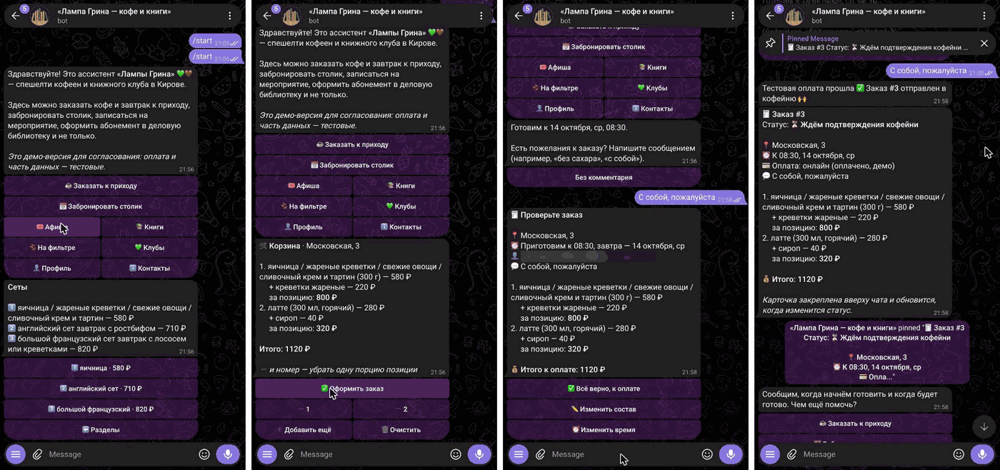

# Ассистент «Лампы Грина» — Telegram-бот для кофейни-библиотеки

Демо Telegram-бота для сети кофеен и книжного клуба «Лампа Грина» (Киров): заказ кофе и завтрака к приходу, бронь столиков, афиша с записью, деловая библиотека, клубы и квиз, профиль с бонусами и панель для персонала.

Сделал по своей инициативе как предложение для кофейни; проект показан с согласия кофейни. Проектировал, собирал данные, писал спецификацию и проверял сам; код писал вместе с Claude Code.



*Заказ к приходу: выбор из меню → корзина → проверка → карточка заказа, которая закрепляется в чате и обновляет статус. Персональные данные на скриншотах скрыты.*

## Что умеет

| Раздел | Гость | Персонал |
|---|---|---|
| ☕ Заказ к приходу | меню своей точки, объём, горячий/холодный, сиропы и добавки, корзина, время выдачи с учётом часов кухни, оплата онлайн (демо) или при получении | принять / готов / выдан / отклонить — гостю приходят статусы, за выданный заказ начисляются бонусы |
| 📅 Бронь столика | точка, день, время, гости, повод, пожелания; отмена из профиля; напоминание за 2 часа | подтвердить / «нет мест» |
| 🎟 Афиша | свободные места, запись 1–4 человек, оплата (демо), билет, лист ожидания, напоминания | список участников, отметка «пришёл», добавление мероприятий |
| 📚 Книги | абонемент деловой библиотеки, каталог и бронь книги, челлендж «12 книг за год», книжный магазин, «Свидание с книгой вслепую» | выдача читательского билета, заявки на книги |
| 🫘 Что на фильтре | актуальное зерно по точкам, подписка на новинки | рассылка подписчикам |
| 💚 Клубы и квизы | заявка в клуб, «Книжный детектив» из 5 раундов с таблицей лидеров | заявки в клубы |
| ℹ️ Контакты | адреса, часы, вопрос администратору, заявка на корпоратив | ответ гостю прямо из бота |
| 👤 Профиль | бонусы, мои заказы / брони / мероприятия | — |
| 🛠 `/admin` | — | сводка на сегодня, стоп-лист по точкам, мероприятия, рассылка |

ИИ-консультант отвечает на вопросы своими словами (включается ключом Anthropic API); без ключа такие вопросы уходят администратору с кнопкой «Ответить».

## Как делал

1. **Сбор данных.** Сообщество кофейни во ВКонтакте и Telegram-канал: адреса, часы, афиша, библиотека, квиз.
2. **Меню.** 12 фотографий меню переписаны в таблицу: 280 позиций по трём точкам с ценами, граммовкой, КБЖУ и временем подачи (`data/menu.csv`). Расхождения между фото вынесены в отдельный список вопросов к кофейне.
3. **Проект бота** — сценарии для гостя и персонала, затем реализация.
4. **Проверка.** `tests/smoke.py` прогоняет все сценарии без Telegram (подменённая сессия); доработки по обратной связи — кнопки без обрезки текста, сводка заказа перед оплатой, закреплённая карточка заказа, русские статусы у персонала.
5. **Презентация** для кофейни — 16 слайдов со скриншотами.

## Технологии

Python, aiogram 3, SQLite (aiosqlite), Anthropic API (ИИ-консультант, по желанию), python-dotenv.

## Запуск

```bash
python3 -m venv .venv && .venv/bin/pip install -r requirements.txt
cp .env.example .env          # вписать BOT_TOKEN от @BotFather
.venv/bin/python bot.py
```

Напишите боту `/start`, затем `/demo_admin` — станете администратором, заявки гостей будут приходить вам в личку. Панель персонала — `/admin`. Проверка всех сценариев: `.venv/bin/python tests/smoke.py`.

Демо-режим: оплата тестовая, часть данных (каталог библиотеки, механика бонусов) — заглушки с пометкой «демо».

## Структура

```
bot.py              точка входа
app/
  content.py        адреса, часы, афиша, «на фильтре», книги, квиз, клубы
  menu.py           загрузка меню из data/menu.csv
  order_card.py     закреплённая карточка заказа
  reminders.py      напоминания о бронях и мероприятиях
  ai.py             ИИ-консультант
  db.py             база заказов, броней, записей
  handlers/         сценарии: заказ, бронь, афиша, книги, сообщество, админка
data/menu.csv       меню трёх точек, перенесённое с фото
tests/smoke.py      прогон всех сценариев без Telegram
```
